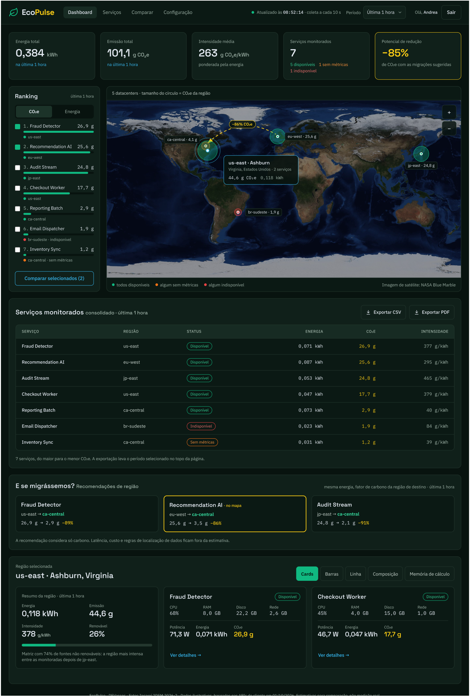
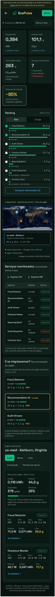
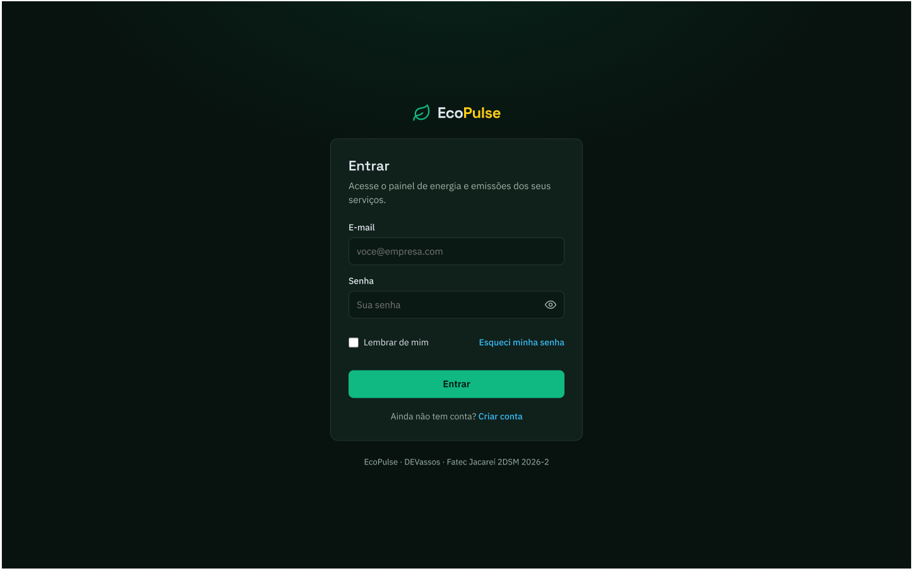
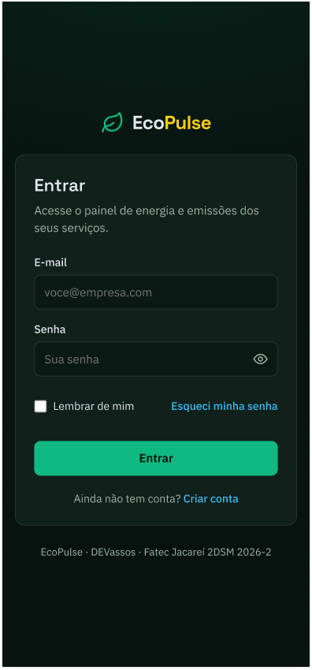
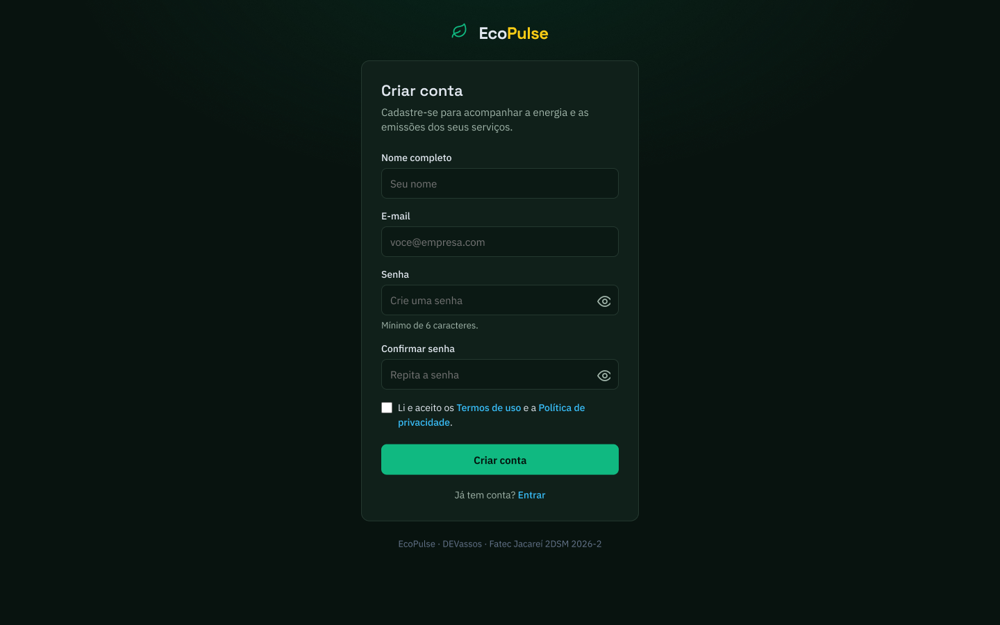
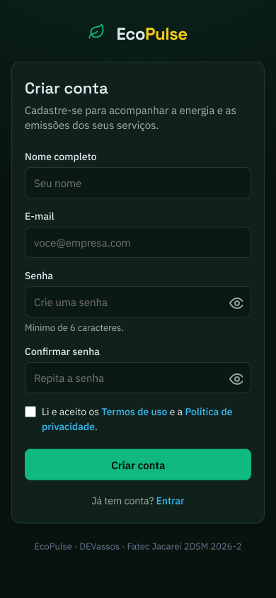

# Protótipo navegável no Figma

Protótipo de alta fidelidade do EcoPulse (UI-01, [#10](https://github.com/DEVassos/greener-app/issues/10)): dashboard, login e cadastro, em desktop e celular, com a paleta verde de [identidade-visual.md](../identidade-visual.md).

- **Apresentação navegável:** [abrir o protótipo](https://www.figma.com/proto/qRkgY2CNlMpvs1BWpHlETr/EcoPulse-%C2%B7-Prot%C3%B3tipo-naveg%C3%A1vel?node-id=15-2&p=f&scaling=scale-down-width&content-scaling=fixed&page-id=0%3A1&starting-point-node-id=15%3A2&show-proto-sidebar=1) (começa no dashboard do visitante; a barra lateral lista as telas)
- **Arquivo de design:** [abrir no Figma](https://www.figma.com/design/qRkgY2CNlMpvs1BWpHlETr/EcoPulse-%C2%B7-Prot%C3%B3tipo-naveg%C3%A1vel)

O acesso é de leitura para qualquer pessoa com o link; não precisa de conta no Figma para ver a apresentação.

## Telas

Cada tela existe em **desktop** (1440 px) e **celular** (390 px).

| # | Tela | O que mostra |
|---|---|---|
| 1 | Dashboard · visitante | faixa "dados ilustrativos", cards de KPI (energia total, emissão total, intensidade média, serviços monitorados, potencial de redução), ranking, mapa dos datacenters, tabela "Serviços monitorados" com **Exportar CSV** e **Exportar PDF**, recomendações de região e painel da região |
| 2 | Dashboard · aviso de login | o mesmo dashboard com o aviso "Entre para continuar", ao tentar usar uma função da área logada |
| 3 | Login | e-mail, senha, "Lembrar de mim" e "Esqueci minha senha" |
| 4 | Dashboard · logado | o dashboard com a saudação ao usuário e o botão **Sair** |
| 5 | Cadastro | nome completo, e-mail, senha e confirmação, aceite dos termos de uso e da política de privacidade |

O **painel da região** tem as cinco abas descritas na seção 4 de [identidade-visual.md](../identidade-visual.md): Cards, Barras, Linha, Composição e Memória de cálculo, também em desktop e celular.

## Fluxo navegável

1. O visitante navega pelo dashboard com dados ilustrativos (uma "degustação" do produto).
2. Ao clicar numa função da área logada (Serviços, Comparar, Configuração, exportar, ver detalhes…), aparece o aviso **Entre para continuar**, com **Entrar**, **Criar conta** e **Agora não**.
3. **Entrar** abre o login; **Criar conta** abre o cadastro (também a partir do link "Ainda não tem conta? Criar conta" no login).
4. No cadastro, **Criar conta** leva ao dashboard logado e "Já tem conta? Entrar" volta ao login.
5. No login, **Entrar** leva ao dashboard logado; no dashboard logado, **Sair** volta ao visitante.

## Relação com o escopo

O protótipo mostra a visão completa do produto; nem tudo entra na Sprint 1:

- Ranking, mapa, recomendações e painel da região estão previstos para a Sprint 3 (US09–US12).
- Os cards de KPI (#21) e o login (#25) estão na Sprint 2.
- A tela de **cadastro** é visão futura: o cadastro ficou **fora do MVP** ([#63](https://github.com/DEVassos/greener-app/issues/63)), e no MVP o usuário inicial nasce junto com o banco. O protótipo a mantém para mostrar o fluxo completo do produto.

## Prints

| Desktop | Celular |
|---|---|
|  |  |
|  |  |
|  |  |
