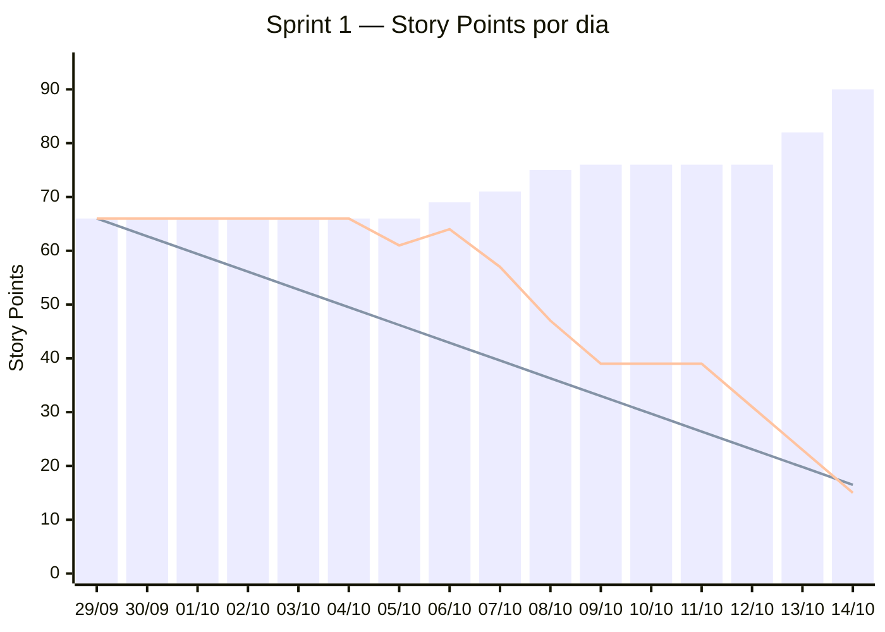

# Burndown — Sprint 1

_Gerado em 14/10/2026 21:02 por `.github/scripts/burndown.sh 1` a partir das issues da milestone [Sprint 1](https://github.com/DEVassos/greener-app/milestones) e do campo **Story Points** do [quadro](https://github.com/orgs/DEVassos/projects/6). Período da sprint: 29/09 a 19/10/2026; dados até 14/10._

Como ler: **barras** = escopo da sprint no dia (soma dos pontos das tarefas já na milestone); **linha que desce reta** = ideal, de 66 pontos no primeiro dia até 0 no último dia da sprint; **outra linha** = pontos ainda abertos no fim de cada dia. Restante acima do ideal indica atraso; barra que sobe indica escopo acrescentado durante a sprint.

## Resumo

| Indicador | Story Points |
|---|---|
| Escopo no primeiro dia (29/09) | 66 |
| Escopo em 14/10 | 90 |
| Concluído (issues fechadas) | 75 |
| Restante | 15 |

## Dia a dia

| Dia | Escopo | Ideal | Restante | Issues fechadas no dia | Issues que entraram no dia |
|---|---|---|---|---|---|
| 29/09 | 66 | 66 | 66 | — | — |
| 30/09 | 66 | 62.7 | 66 | — | — |
| 01/10 | 66 | 59.4 | 66 | — | — |
| 02/10 | 66 | 56.1 | 66 | — | — |
| 03/10 | 66 | 52.8 | 66 | — | — |
| 04/10 | 66 | 49.5 | 66 | — | — |
| 05/10 | 66 | 46.2 | 61 | [#1](https://github.com/DEVassos/greener-app/issues/1) | — |
| 06/10 | 69 | 42.9 | 64 | — | [#58](https://github.com/DEVassos/greener-app/issues/58), [#56](https://github.com/DEVassos/greener-app/issues/56) |
| 07/10 | 71 | 39.6 | 57 | [#56](https://github.com/DEVassos/greener-app/issues/56), [#28](https://github.com/DEVassos/greener-app/issues/28), [#11](https://github.com/DEVassos/greener-app/issues/11), [#3](https://github.com/DEVassos/greener-app/issues/3) | [#65](https://github.com/DEVassos/greener-app/issues/65), [#64](https://github.com/DEVassos/greener-app/issues/64) |
| 08/10 | 75 | 36.3 | 47 | [#67](https://github.com/DEVassos/greener-app/issues/67), [#22](https://github.com/DEVassos/greener-app/issues/22), [#9](https://github.com/DEVassos/greener-app/issues/9), [#5](https://github.com/DEVassos/greener-app/issues/5), [#4](https://github.com/DEVassos/greener-app/issues/4) | [#80](https://github.com/DEVassos/greener-app/issues/80), [#67](https://github.com/DEVassos/greener-app/issues/67), [#66](https://github.com/DEVassos/greener-app/issues/66) |
| 09/10 | 76 | 33 | 39 | [#87](https://github.com/DEVassos/greener-app/issues/87), [#80](https://github.com/DEVassos/greener-app/issues/80), [#66](https://github.com/DEVassos/greener-app/issues/66), [#65](https://github.com/DEVassos/greener-app/issues/65), [#64](https://github.com/DEVassos/greener-app/issues/64), [#8](https://github.com/DEVassos/greener-app/issues/8) | [#87](https://github.com/DEVassos/greener-app/issues/87) |
| 10/10 | 76 | 29.7 | 39 | — | — |
| 11/10 | 76 | 26.4 | 39 | — | — |
| 12/10 | 76 | 23.1 | 31 | [#15](https://github.com/DEVassos/greener-app/issues/15), [#14](https://github.com/DEVassos/greener-app/issues/14) | — |
| 13/10 | 82 | 19.8 | 23 | [#26](https://github.com/DEVassos/greener-app/issues/26), [#17](https://github.com/DEVassos/greener-app/issues/17), [#12](https://github.com/DEVassos/greener-app/issues/12), [#10](https://github.com/DEVassos/greener-app/issues/10), [#7](https://github.com/DEVassos/greener-app/issues/7) | [#106](https://github.com/DEVassos/greener-app/issues/106), [#104](https://github.com/DEVassos/greener-app/issues/104), [#103](https://github.com/DEVassos/greener-app/issues/103), [#97](https://github.com/DEVassos/greener-app/issues/97) |
| 14/10 | 90 | 16.5 | 15 | [#104](https://github.com/DEVassos/greener-app/issues/104), [#97](https://github.com/DEVassos/greener-app/issues/97), [#27](https://github.com/DEVassos/greener-app/issues/27), [#23](https://github.com/DEVassos/greener-app/issues/23), [#19](https://github.com/DEVassos/greener-app/issues/19) | [#117](https://github.com/DEVassos/greener-app/issues/117), [#112](https://github.com/DEVassos/greener-app/issues/112), [#111](https://github.com/DEVassos/greener-app/issues/111) |

## Fora da soma

- Histórias (`tipo:historia`) e épicos: os pontos deles já estão nas tarefas filhas.
- Issues sem Story Points no quadro: [#109](https://github.com/DEVassos/greener-app/issues/109), [#102](https://github.com/DEVassos/greener-app/issues/102), [#78](https://github.com/DEVassos/greener-app/issues/78), [#74](https://github.com/DEVassos/greener-app/issues/74), [#73](https://github.com/DEVassos/greener-app/issues/73), [#72](https://github.com/DEVassos/greener-app/issues/72), [#70](https://github.com/DEVassos/greener-app/issues/70), [#59](https://github.com/DEVassos/greener-app/issues/59).

## Método

- Uma issue entra no escopo no dia em que foi criada (ou no primeiro dia da sprint, se é anterior) e sai do restante no dia em que foi fechada (merge do PR em `develop` para tarefas), no horário de Brasília.
- Data-base desta sprint: 05/10 (`burndown_base` em `.github/calendario.json`). As issues criadas até essa data contam como escopo planejado desde 29/09, porque o backlog chegou ao GitHub depois do início da sprint.
- A lista de issues é a da milestone no momento da geração: issue movida para outra sprint deixa de aparecer em todos os dias, e o motivo fica no [histórico do plano](../../plano-de-entregas.md#histórico-de-alterações-do-plano).
