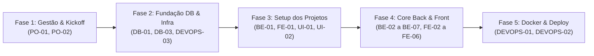

# Registro de Planejamento da Sprint 1

- **Projeto:** GreenER — Plataforma de Estimativa do Impacto Ambiental de Software
- **Semestre/Curso:** 2º DSM — Fatec Jacareí
- **Data da Sprint Review 1:** 19/10/2026 às 19h30
- **Arquivo:** `docs/sprints/sprint-1/planning.md` (planejamento do PO; o registro oficial da sprint fica em `docs/sprints/sprint-1.md`, a Definition of Done oficial em `docs/processo/definition-of-done.md` e o padrão de commit em `.github/CONTRIBUTING.md`)
- **Revisão de 15/10/2026:** este documento registra o planejamento combinado pela equipe a partir de 29/09, antes de existir repositório (discussões e acertos iniciais), versionado em 04/10 no Projeto-GreenER, replanejado em 05/10 e importado para este repositório em 07/10 (PR [#57](https://github.com/DEVassos/greener-app/pull/57)). A composição vigente da sprint (19 itens, 79 pontos), os critérios previstos e as evidências por critério estão em [`docs/plano-de-entregas.md`](../../plano-de-entregas.md); as verificações executadas estão em [`docs/sprints/sprint-1.md`](../sprint-1.md).

---

## 1. Objetivo da Sprint 1

Construir e disponibilizar a **arquitetura base e o fluxo funcional de ponta a ponta (MVP)** do GreenER em ambiente totalmente containerizado via Docker. O escopo da Sprint 1 compreende a descoberta e a ingestão periódica dos serviços no agregador de métricas, a persistência do histórico em PostgreSQL nativo sem ORM, a exibição dos serviços com estado de monitoramento e localização na interface web React em TypeScript e a subida de toda a aplicação com `docker compose up --build`.

> **Nota de escopo (revista em 05/10/2026):** o texto original desta seção previa também **autenticação JWT da área restrita (RP06)**, **motor de cálculo socioambiental (Potência, Energia e CO₂e)** e o **Mecanismo Global de Exportação de Relatórios Gerenciais (PDF e CSV)** na Sprint 1. O replanejamento de 05/10 retirou essas três frentes da sprint — JWT (`DW06`) e motor de cálculo (`TP01`) passaram para a Sprint 2 e a exportação para a Sprint 3 —, com o motivo registrado em cada issue movida (#6, #18, #20, #21 e #25 para a Sprint 2; #13 e #24 para a Sprint 3) e no [histórico de alterações do plano](../../plano-de-entregas.md).

---

## 2. Indicadores e Meta da Sprint (Story Points & Rubrica)

- **Composição vigente da Sprint 1 (05/10/2026):** **19 itens; denominador de 79 pontos da rubrica** — detalhamento em [`plano-de-entregas.md`](../../plano-de-entregas.md).
- **Critérios da rubrica previstos para a Sprint 1:** ES01 a ES09 (40 pts), DW01 (3), DW02 (5), DW03 (6), DW04 (4), DW07 (3), BD01 (4), BD02 (6), BD03 (2) e TP02 (6) = **79 pontos**.
- **Versão original deste planejamento (29/09/2026), mantida na §4:** 100 pontos, 82 Story Points em 25 tarefas, com autenticação JWT (DW06), motor de cálculo (TP01) e exportação de relatórios no escopo; o replanejamento de 05/10 tirou essas frentes e reduziu a sprint aos 79 pontos vigentes.
- **Acréscimo desta revisão (29/09/2026):** +13 Story Points / +4 tarefas referentes à **autenticação JWT (RP06 / DW06)** e ao provimento de segredos do ambiente Docker — a área restrita é da Sprint 2.

---

## 3. Sequência Lógica de Execução (Fases de Desenvolvimento)

Para otimizar o fluxo de trabalho da equipe e respeitar as dependências técnicas entre banco, backend e frontend, as tarefas devem ser atacadas nas seguintes fases:

> **Nota de 15/10/2026:** o diagrama e a tabela da §4 registram o **planejamento inicial de 29/09/2026**. No replanejamento de 05/10, as tarefas marcadas com ➡️ saíram da Sprint 1 (#6 `DB-03`, #18 `BE-05`, #20 `BE-07`, #21 `FE-02` e #25 `FE-06` para a Sprint 2; #13 `UI-04` e #24 `FE-05` para a Sprint 3) e a sprint passou a **19 itens e 79 pontos**. A composição vigente, com responsáveis e evidências, está em [`plano-de-entregas.md`](../../plano-de-entregas.md).

---

## 4. Sprint Backlog, Estimativas e Distribuição de Responsáveis

> 🤝 **Princípio da Colaboração Ágil:** A indicação de um **Responsável Principal** garante a rastreabilidade individual exigida nas rubricas da Fatec (ES05/ES06) e um equilíbrio justo de carga de trabalho (~16 Story Points por integrante). No entanto, toda a equipe pratica *Pair Programming* e cooperação mútua em qualquer camada sempre que necessário.

| Código | Camada | Descrição da Tarefa / Entregável | Critério Fatec | Requisito | Points | Responsável Principal | Apoio / Colaboração |
| :--- | :--- | :--- | :---: | :---: | :---: | :--- | :--- |
| **PO-01** | Gestão | Versionamento do arquivo `docs/plano-de-entregas.md`. | ES01, ES02 | RP05, RP07 | **2** | **Henrique Camargo** | Gabriel Travensolli |
| **PO-02** | Gestão | Cadastro, priorização e vinculação das Issues no GitHub. | ES04, ES09 | RP07 | **2** | **Henrique Camargo** | Gabriel Travensolli |
| **DB-01** | Banco | Script DDL `database/schema.sql` com tabelas, PK/FK e restrições. | BD01 | RP03, RF10 | **3** | **Lucas Amorim** | Vinicius Augusto |
| ➡️ **DB-03** | Banco | Script de seed `database/seed.sql` com usuário admin (hash bcrypt). | BD01 | RP06 | **2** | **Vinicius Augusto** | Lucas Amorim |
| **DEVOPS-03** | DevOps | Provisionamento de segredos: `.env.example` e `JWT_SECRET` no compose. | DW07, DW06 | RP04, RP06 | **3** | **Henrique Camargo** | Lucas Amorim |
| **BE-01** | Backend | Setup da API REST Node.js/TS em camadas (módulos, controllers, etc.). | DW01, DW03 | RP02 | **3** | **Lucas Amorim** | Vinicius Augusto |
| **FE-01** | Frontend | Setup do projeto React + TypeScript + Vite + Tailwind (RP01). | DW01, DW04 | RP01 | **2** | **Gabriel Travensolli** | Andrea Turibio |
| **UI-01** | Design | Protótipo de alta fidelidade no Figma (KPIs, lista e modal). | ES03, RP05 | RNF01 | **5** | **Gabriel Travensolli** | Andrea Turibio |
| **UI-02** | Design | Definição do Design System Dark Mode (`slate-950`, `emerald-500`). | ES07 | RNF01 | **2** | **Gabriel Travensolli** | Andrea Turibio |
| **UI-03** | Design | Componentização do indicador visual de última atualização. | ES03 | RNF02 | **1** | **Gabriel Travensolli** | Andrea Turibio |
| ➡️ **UI-04** | Design | Layout do Relatório Executivo PDF (Cabeçalho, KPIs e tabela impressa). | ES03, RP05 | Diferencial | **2** | **Andrea Turibio** | Gabriel Travensolli |
| **DB-02** | Banco | Repositories com SQL puro parametrizado no driver `pg` (Sem ORM). | BD02 | RP03, RF10 | **5** | **Lucas Amorim** | Vinicius Augusto |
| **BE-02** | Backend | Cliente HTTP para consumo da API Agregadora de Métricas. | DW02, DW03 | RF01, RF03 | **3** | **Lucas Amorim** | Vinicius Augusto |
| **BE-03** | Backend | Tratamento de exceções (HTTP 500 `unavailable` e 404 `metrics_missing`). | DW02, TP03 | RF05, RF06, RNF04 | **3** | **Lucas Amorim** | Vinicius Augusto |
| **BE-04** | Backend | Cliente HTTP para consumo da API de Intensidade de Carbono. | DW02 | RF07 | **2** | **Vinicius Augusto** | Lucas Amorim |
| ➡️ **BE-05** | Backend | Domain Service do Cálculo Socioambiental com constantes oficiais. | TP01, TP02, DW03 | RF07 | **5** | **Vinicius Augusto** | Lucas Amorim |
| **BE-06** | Backend | Worker/Cron em segundo plano para o ciclo de coleta periódica. | DW03 | RF02, RF04 | **5** | **Vinicius Augusto** | Lucas Amorim |
| ➡️ **BE-07** | Backend | Autenticação JWT: rota `POST /login` (bcrypt) e middleware de rotas. | DW06, TP03 | RP06 | **5** | **Vinicius Augusto** | Lucas Amorim |
| ➡️ **FE-02** | Frontend | Componentização dos Cards de KPI Executivos (kWh, gCO₂e, serviços). | DW04, DW05 | RF08, RF09 | **3** | **Gabriel Travensolli** | Andrea Turibio |
| **FE-03** | Frontend | Tabela Operacional de Serviços com badges de status e localização. | DW04, DW05 | RF09, RF12 | **5** | **Andrea Turibio** | Gabriel Travensolli |
| **FE-04** | Frontend | Hook customizado de _polling_ e cronômetro de atualização sem reload. | DW05 | RF11, RNF02 | **5** | **Andrea Turibio** | Gabriel Travensolli |
| ➡️ **FE-05** | Frontend | Hook/Módulo Global de Exportação de Dados (Geração de CSV e PDF). | DW04 | Diferencial | **5** | **Andrea Turibio** | Gabriel Travensolli |
| ➡️ **FE-06** | Frontend | Tela de Login, guarda de rotas e armazenamento do token (área restrita). | DW06 | RP06 | **3** | **Henrique Camargo** | Gabriel Travensolli |
| **DEVOPS-01** | DevOps | Dockerfiles otimizados para Frontend e Backend. | DW07 | RP04 | **3** | **Gabriel Travensolli** | Henrique Camargo |
| **DEVOPS-02** | DevOps | Configuração do `compose.yaml` com volume persistente PostgreSQL. | DW07, BD03 | RP04, RNF05 | **3** | **Henrique Camargo** | Gabriel Travensolli |

### ⚖️ Balanço de Capacidade por Integrante

| Integrante | Papel Principal | Tarefas Atribuídas | Story Points Alocados |
| :--- | :--- | :--- | :---: |
| **Gabriel Travensolli** | Scrum Master / Front / UI | `UI-01`, `UI-02`, `UI-03`, `FE-01`, `FE-02`, `DEVOPS-01` | **16 pts** |
| **Andrea Turibio** | Dev Front-end / UI | `UI-04`, `FE-03`, `FE-04`, `FE-05` | **17 pts** |
| **Lucas Amorim** | Dev Back-end / DB | `DB-01`, `DB-02`, `BE-01`, `BE-02`, `BE-03` | **17 pts** |
| **Vinicius Augusto** | Dev Back-end / Segurança | `DB-03`, `BE-04`, `BE-05`, `BE-06`, `BE-07` | **19 pts** |
| **Henrique Camargo** | Product Owner / Gestão & DevOps | `PO-01`, `PO-02`, `FE-06`, `DEVOPS-02`, `DEVOPS-03` | **13 pts + Gestão** |
| **Total da Sprint 1 (planejamento inicial, 29/09)** | — | **25 tarefas** | **82 pts** |
| **Total vigente da Sprint 1 (05/10/2026)** | — | **19 itens** | — (79 são pontos da rubrica, não Story Points; ver §2) |

> Os totais por integrante acima são os do planejamento inicial e não descontam as tarefas que saíram da sprint; a distribuição vigente por responsável, com as evidências, está em [`plano-de-entregas.md`](../../plano-de-entregas.md) § Participação dos integrantes.

---

## 5. Definition of Done (DoD) da Sprint 1

Para que qualquer tarefa ou história seja considerada **Concluída**, os seguintes critérios devem ser atendidos rigorosamente:

1. **Padrão Code Base:** Código escrito em TypeScript estrito, sem utilização de `any` injustificado.
2. **Restrição de Banco de Dados:** **Proibição total de ORMs** (Prisma, TypeORM, etc.). Toda interação com o PostgreSQL deve ser feita via DML SQL puro parametrizado no driver `pg`.
3. **Resiliência de Ingestão:** Métricas do worker devem tratar erros HTTP 500 e 404 sem derrubar a API ou interromper a coleta dos demais serviços.
4. **Mecanismo de Exportação (Sprint 3):** Toda visualização principal ou tabela deve possuir suporte a exportação em CSV estruturado e impressão/PDF estilizado. Fora da Sprint 1 — as tarefas `FE-05` (#24) e `UI-04` (#13) migraram para a Sprint 3.
5. **Reprodutibilidade Docker:** A aplicação deve subir completamente via comando `docker compose up --build` sem erros de conexão, com todas as variáveis documentadas no `.env.example` (`POSTGRES_*`, `PORT`, `DATABASE_URL`, `METRICS_API_URL`, `CARBON_API_URL`, `POLLING_INTERVAL_MS`, `CORS_ORIGIN`, `VITE_API_URL`) e nenhum arquivo `.env` versionado. O `JWT_SECRET` e o `JWT_EXPIRES_IN` já estão no arquivo de exemplo, mas só passam a ser consumidos na Sprint 2, com o `DW06`.
6. **Segurança de Acesso (JWT — Sprint 2, `DW06`):** A área restrita (configuração) só é acessível com token válido. Rotas protegidas retornam `401` sem token e `403` com token expirado/inválido. Senhas nunca são armazenadas em texto puro (bcrypt). Na Sprint 1 o critério aplicável é **nenhum segredo versionado** (só `.env.example`).
7. **Rastreabilidade Git:** Commits seguem `.github/CONTRIBUTING.md` — `type(scope): descrição no imperativo (#issue) [RFxx]`, com o número da issue que a mudança atende. Exemplo: `feat(frontend): adiciona exportação do relatório em PDF (#24) [RF09]`.

---

## 6. Rastreabilidade e Evidências da Rubrica (`docs/plano-de-entregas.md`)

A tabela vigente de critérios — com `Entrega concreta`, `Como verificar`, responsáveis, evidência (permalink) e Situação — é a de [`docs/plano-de-entregas.md`](../../plano-de-entregas.md) § Sprint 1. Este documento não a duplica, para não manter duas versões divergentes.

**Situação apurada em 15/10/2026** (detalhe e permalinks no plano):

| Critério | Situação em 15/10/2026 |
| :--- | :--- |
| ES01, ES02, ES03, ES04, ES05, ES07 | Concluído |
| ES06 (review e feedback) e ES09 (participação) | Em andamento — fecham até 20/10, depois da review de 19/10 |
| ES08 | Parcial — `README.md`, `docs/api.md` e `docs/arquitetura.md` em dia; `backend/README.md` e `database/README.md` desatualizados |
| DW01, DW02, DW03, DW04, DW07, BD01, BD02, BD03, TP02 | Concluído |
| DW05, DW06, TP01, TP03 | Fora da Sprint 1: previstos para a Sprint 2 |

As tarefas `DB-03` (#6), `BE-05` (#18), `BE-07` (#20), `FE-02` (#21) e `FE-06` (#25) da §4 estão fora da Sprint 1 (Sprint 2), assim como `UI-04` (#13) e `FE-05` (#24) (Sprint 3).

---

## 7. Registro de Revisão e Decisões (Sprint Review 1)

*(A ser preenchido na reunião do dia 19/10/2026 após o feedback do professor e cliente UniLaunch)*

- **Status da Entrega:** [ ] Aprovado de Primeira | [ ] Aprovado com Ressalvas
- **Pontos Fortes Destacados:**
- **Oportunidades de Melhoria / Retorno Recebido:**
- **Ajustes Mapeados para a Sprint 2:**
