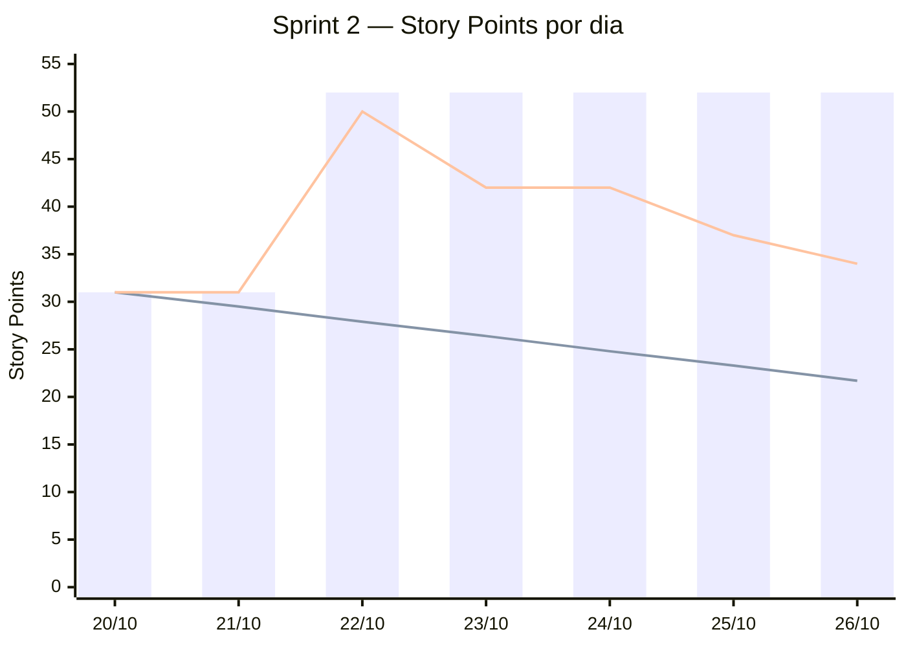

# Burndown — Sprint 2

_Gerado em 26/10/2026 23:44 por `.github/scripts/burndown.sh 2` a partir das issues da milestone [Sprint 2](https://github.com/DEVassos/greener-app/milestones) e do campo **Story Points** do [quadro](https://github.com/orgs/DEVassos/projects/6). Período da sprint: 20/10 a 09/11/2026; dados até 26/10._

Como ler: **barras** = escopo da sprint no dia (soma dos pontos das tarefas já na milestone); **linha que desce reta** = ideal, de 31 pontos no primeiro dia até 0 no último dia da sprint; **outra linha** = pontos ainda abertos no fim de cada dia. Restante acima do ideal indica atraso; barra que sobe indica escopo acrescentado durante a sprint.

## Resumo

| Indicador | Story Points |
|---|---|
| Escopo no primeiro dia (20/10) | 31 |
| Escopo em 26/10 | 52 |
| Concluído (issues fechadas) | 18 |
| Restante | 34 |

## Dia a dia

| Dia | Escopo | Ideal | Restante | Issues fechadas no dia | Issues que entraram no dia |
|---|---|---|---|---|---|
| 20/10 | 31 | 31 | 31 | — | — |
| 21/10 | 31 | 29.5 | 31 | — | — |
| 22/10 | 52 | 27.9 | 50 | [#180](https://github.com/DEVassos/greener-app/issues/180) | [#203](https://github.com/DEVassos/greener-app/issues/203), [#194](https://github.com/DEVassos/greener-app/issues/194), [#193](https://github.com/DEVassos/greener-app/issues/193), [#190](https://github.com/DEVassos/greener-app/issues/190), [#189](https://github.com/DEVassos/greener-app/issues/189), [#188](https://github.com/DEVassos/greener-app/issues/188) |
| 23/10 | 52 | 26.4 | 42 | [#173](https://github.com/DEVassos/greener-app/issues/173), [#132](https://github.com/DEVassos/greener-app/issues/132), [#21](https://github.com/DEVassos/greener-app/issues/21) | — |
| 24/10 | 52 | 24.8 | 42 | — | — |
| 25/10 | 52 | 23.3 | 37 | [#193](https://github.com/DEVassos/greener-app/issues/193), [#188](https://github.com/DEVassos/greener-app/issues/188) | — |
| 26/10 | 52 | 21.7 | 34 | [#189](https://github.com/DEVassos/greener-app/issues/189) | — |

## Fora da soma

- Histórias (`tipo:historia`) e épicos: os pontos deles já estão nas tarefas filhas.
- Issues sem Story Points no quadro: [#210](https://github.com/DEVassos/greener-app/issues/210), [#205](https://github.com/DEVassos/greener-app/issues/205), [#198](https://github.com/DEVassos/greener-app/issues/198), [#187](https://github.com/DEVassos/greener-app/issues/187), [#186](https://github.com/DEVassos/greener-app/issues/186), [#181](https://github.com/DEVassos/greener-app/issues/181), [#178](https://github.com/DEVassos/greener-app/issues/178), [#177](https://github.com/DEVassos/greener-app/issues/177), [#172](https://github.com/DEVassos/greener-app/issues/172), [#169](https://github.com/DEVassos/greener-app/issues/169), [#168](https://github.com/DEVassos/greener-app/issues/168), [#167](https://github.com/DEVassos/greener-app/issues/167), [#166](https://github.com/DEVassos/greener-app/issues/166), [#165](https://github.com/DEVassos/greener-app/issues/165), [#164](https://github.com/DEVassos/greener-app/issues/164), [#163](https://github.com/DEVassos/greener-app/issues/163), [#162](https://github.com/DEVassos/greener-app/issues/162), [#161](https://github.com/DEVassos/greener-app/issues/161), [#160](https://github.com/DEVassos/greener-app/issues/160), [#159](https://github.com/DEVassos/greener-app/issues/159).

## Método

- Uma issue entra no escopo no dia em que foi criada (ou no primeiro dia da sprint, se é anterior) e sai do restante no dia em que foi fechada (merge do PR em `develop` para tarefas), no horário de Brasília.
- A lista de issues é a da milestone no momento da geração: issue movida para outra sprint deixa de aparecer em todos os dias, e o motivo fica no [histórico do plano](../../plano-de-entregas.md#histórico-de-alterações-do-plano).
